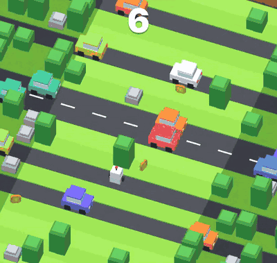
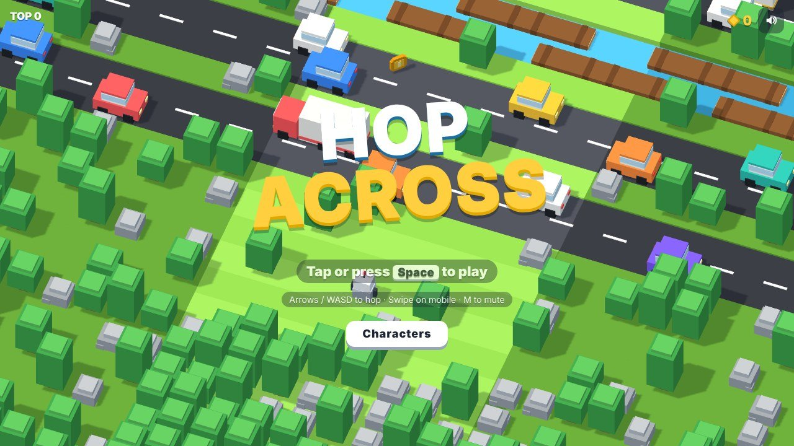
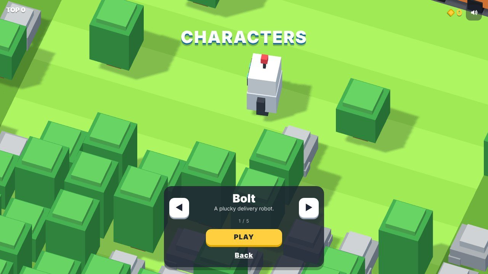
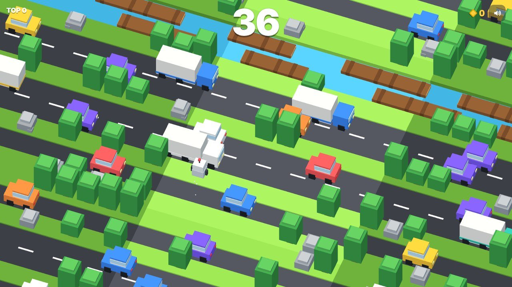
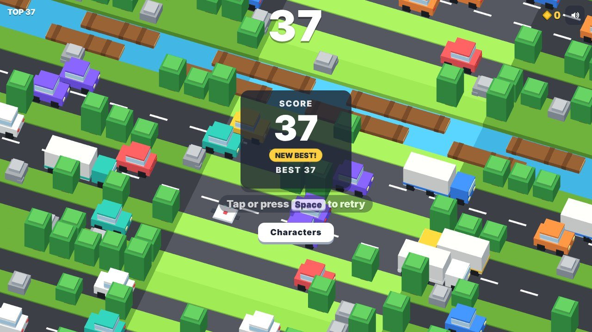

<div align="center">



# 🚗 🐾 HOP ACROSS 🐾 🚂

### Roads, rails and rivers. How far can you hop?

<a href="https://gorzawebk.github.io/hop-across/"></a>


<sub>▲ A real run, recorded in the browser.</sub>

🟩🟩🟩⬛⬛⬛🟩🟦🟦🟦🟩⬛⬛⬛🟩🟩🟩

</div>

An original, endless "hop across the lanes" arcade game for the browser, built with
[Three.js](https://threejs.org/) and low-poly voxel graphics.

Works on desktop (keyboard) and phones (tap / swipe).

<table>
<tr><td align="center" valign="top"><br><sub>Title screen</sub></td><td align="center" valign="top"><br><sub>Pick a character</sub></td></tr>
<tr><td align="center" valign="top"><br><sub>Rush hour</sub></td><td align="center" valign="top"><br><sub>Splat. Score 37.</sub></td></tr>
</table>

## 💻 Run it

```bash
npm install
npm run dev        # http://localhost:5173 (also printed on your LAN for phone testing)
```

Production build (static files in `dist/`, open from any web server):

```bash
npm run build
npm run preview
```

## 🎮 Controls

| Action        | Desktop          | Mobile             |
| ------------- | ---------------- | ------------------ |
| Hop forward   | ↑ / W            | Tap or swipe up    |
| Hop back      | ↓ / S            | Swipe down         |
| Hop left/right| ← → / A D        | Swipe left / right |
| Start / retry | Space / Enter    | Tap                |
| Characters    | C (Esc to close) | "Characters" button|
| Mute          | M                | Speaker button     |

## ⚡ Why Vite instead of a CDN script tag?

Three.js is installed from npm and bundled by Vite. That keeps the code in clean ES modules
with real imports, gives instant hot-reload while developing, and produces a single small
static bundle that works offline and doesn't depend on a third-party CDN being reachable.

## 🗂️ Code layout

```
src/
  main.js        game bootstrap, state machine, main loop
  config.js      tuning constants + small helpers
  voxel.js       box-list -> merged, vertex-colored geometry (1 draw call per model, cached)
  models.js      world models: ground strips, trees, rocks, vehicles...
  characters.js  playable characters
  lanes.js       lane types: grass, road, river (logs / lily pads), railway
  events.js      tiny event bus (gameplay -> audio/effects)
  world.js       procedural lane generator, spawning ahead / recycling behind
  player.js      grid hopping, input queue, squash & stretch, death states
  camera.js      fixed isometric orthographic camera rig (auto-scrolls forward)
  hunter.js      the sky hunter that snatches players who lag behind
  input.js       keyboard + touch (tap / swipe)
  effects.js     particle puffs (one InstancedMesh = one draw call)
  audio.js       Web Audio synthesised sound effects + mute
  ui.js          DOM HUD and screens
  storage.js     localStorage wrapped in try/catch
```

## 🏎️ Performance notes

- Every model is a single merged, vertex-coloured geometry sharing one material, cached and
  reused, so a car or tree is one draw call and recycling lanes never uploads new buffers.
- Lanes are generated ~22 rows ahead and removed ~9 rows behind the camera.
- Particles are a single `InstancedMesh`.
- If the frame rate stays under ~50 fps the game lowers the pixel ratio, and as a last
  resort turns off shadows.

## 🚀 Deployment

Every push to `main` builds the game and publishes it to GitHub Pages via
`.github/workflows/deploy.yml`. One-time setup: in the repository's
**Settings → Pages**, set **Source** to **GitHub Actions**.

---

<div align="center">

🟩🟩🟩⬛⬛⬛🟩🟦🟦🟦🟩⬛⬛⬛🟩🟩🟩

**Look both ways. Then hop.**

</div>
